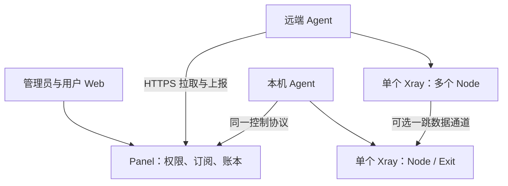

# Panel-Agent 完整项目计划

版本：v0.4 · 编制日期：2026-10-20 · 任务修订：2026-10-22 · 用途：产品与技术基线；执行入口见 [tasks/README.md](tasks/README.md)。

原始依据：[Panel-Agent Chat 会话](https://chatgpt.com/c/6ad6dd20-0c2c-83e9-a417-ccffa3f1b0d0)。本文件依据该会话从「三毛机场 1.0 和 2.0 的具体区别」开篇、十八轮需求讨论、Build vs Fork Review，直到「压缩吧」后的完整设计总结整理，已直接读取正文，并非仅依据跨会话记忆摘要。

本文件保存于用户指定的项目目录 `E:\project\Panel-Agent`。编制时目录为空，没有现有代码或 AGENTS.md。当前只交付项目计划，不表示已实现、测试、发布或证明任何资源指标。

**执行规则：用户后续明确修订 > 会话最终确认 > 早期讨论建议。本文区分「已确认的产品要求」与「工程建议/待验证细节」；后者不得冒充用户已经逐项确认的要求。** 原会话里的外部项目介绍只作为当时选型记录，不视作对其当前版本、许可证或性能的重新核实。

## 1. 产品定位与成功标准

### 官方 Hysteria 2 补充契约（2026-10-28）

用户新增 hy2 并指定使用官方 Hysteria 2 内核。本节覆盖下文旧基线中的 Xray-only、单 Core 和禁止多 Core 限制，仅限新增的官方 Hysteria 2 适配；不引入任意插件进程或多跳。实施入口为 [D13-HY2](tasks/D13-hysteria2-official-core.md)，执行状态仍只保存在任务索引，D17 保留最终发布验收职责。

- 每机一个 Agent；Xray 合并管理其全部入口，Hysteria 按独立监听入口管理实例，仅启动实际需要的内核。两者独立配置、版本、进程身份和回滚，机器级操作串行协调。任何一个必需实例未应用成功，不报告整机 desired state 已完成。
- Hysteria 使用 Agent 回环 HTTP 认证和官方流量/踢人 API；认证标识绑定 User×Node。认证依据本地已应用授权、到期和配额，Panel 离线不额外引入依赖。撤销先拒绝新认证，再终止旧连接；踢人失败必须关闭受影响实例并报告，不能继续带着旧权限服务。
- 统计读取不清零，以独立 Core 实例和 generation 区分累计水位，复用现有持久账本、补报和幂等入账。采样及映射切换失败不得静默丢账，重启无法恢复的未观测区间明确记录 gap；机器预算聚合两种内核。
- 首阶段 hy2 支持 Direct、标准 URI、Mihomo、TLS 证书验证。One-Hop 在独立适配并验收之前明确不可用；已有 Reality One-Hop 不变。多实例资源、双内核共存和升级峰值单独验收，不能继承单 Xray 的 128MB 结论，也不降低原有 Reality 最低规格门槛。
- 测试资源限凤凰城、两台冰岛 NAT、一台日本 NAT。用户确认懒猫 NAT 提供 UDP 映射但尚未设置，这是后续测试准备项，不是开发阻塞。公网 UDP 端口用于订阅，本地 UDP 端口用于监听；同公网 IP 的两台冰岛必须按 SSH 端口、主机名及内网地址区分。
- 当前先开发，测试与部署暂缓；可编写验证用例，但未执行不得记录通过。后续测试需隔离目录、端口和进程，保留原服务与现有映射，不自动发布。

Panel-Agent 是面向个人、熟人小圈子及开源自建的极简多节点代理控制平面。以 **128MB RAM / 1GB 磁盘 NAT VPS** 为节点端设计基准，集中管理用户、权限、节点、订阅和流量，节点只运行极薄 Agent 与 Xray Core。

解决的实际痛点是：新增节点时必须逐用户添加外部链接、节点机也要安装完整面板、NAT 小机资源不足，以及管理员被迫理解大量 Inbound / Outbound / Routing / JSON 概念。

项目成功必须同时满足：

- 新增 Node 并加入授权 NodeGroup 后，有权限的用户刷新订阅即可获得节点，管理员无需逐用户修改。
- 一台 Machine 只运行一个 Agent 和一个 Xray Core，所有 Node 合并管理，不按 Node 启动多个 Core。
- Agent 主动访问 Panel，控制通道不要求 NAT 提供公网管理端口。
- Panel 离线不导致代理服务立即停止；Agent 保留可用配置并持久记录流量，恢复后幂等补账。
- 默认管理界面围绕用户、组、机器、节点、配额与订阅；协议参数只出现在必要的高级设置。
- Panel 与 Agent 都执行有界日志、垃圾清理和数据保留策略，不能靠运行时间不断吃盘。
- 128MB 基准实测通过后，才可宣称支持该最低规格；不能降为「256MB 起，128MB 尽力」。

核心职责原则：**Panel 决定谁能用什么；Agent 安全地落实目标状态；Xray 实际代理流量。**

## 2. 最终决策与被替代方案

### 2.1 必须沿用的最终决定

1. 自研 Control Plane + 自研 Thin Agent，不以完整商业面板或现成 Node 的 fork 作为主体；参考成熟工程实现。
2. V1 单管理员；用户由管理员手动或批量创建，无自注册、无用户账号密码体系。
3. 权限仅用模型 B：User → 单个 UserGroup → 若干 NodeGroup → Nodes。
4. 实验节点用 NodeGroup 隔离，不增加一套 testing / stable 发布状态机，也不做逐用户节点授权。
5. 配额模板 QuotaTemplate 在第九轮被明确删除。批量创建时直接填写配额、组、有效期。
6. Machine 与 Node 分离；不增加独立 Endpoint 实体。链式场景保留隐藏的 Exit，不能混同 Endpoint。
7. 用户全局周期配额、User×Node 配额、Machine 周期预算同时存在，支持各自重置。
8. 离线应急额度、Emergency Bypass、Quota Lease 均已从 V1 删除；离线继续服务并补账。
9. 客户端智能分流属于 V1；不把「国内直连」错误实现为远端服务器 direct 出站。
10. 服务端保留 Direct / One-Hop Exit 两种路径；只支持一跳，出口故障 Fail Closed。
11. V1 核心仅实现 Xray Adapter，VLESS Reality 为一等公民，但不能把模型写死为 Reality-only。
12. AI 仅在外部生成受限声明式协议包；Panel 导入、验证、启停、删除，不内置 AI 聊天或模型 API。
13. Panel 可手动触发 Xray 升级；Agent 自身 V1 仅本机 CLI 更新，不远程自升级，不定时自动更新。
14. Dashboard Token 与 Subscription Token 分离；默认随机，管理员可自定义前缀或高级完整值。
15. NAT 公网地址、外部端口、本地端口由管理员填写；本地端口默认手填，不能改回自动分配。
16. 动态 NAT / DNS / 协议教程属于 V1，按当前数据生成可复制配置及检测结果。
17. 普通卸载保留数据，显式 `--purge` 才彻底删除项目自身数据；用户已有 Xray 不得误删。
18. 节点最低 128MB 是硬验收门槛；256MB+ 只是推荐环境。Panel+本机节点目标为 1C / 512MB。

### 2.2 明确撤回或不应恢复的早期提议

- 「保留配额模板」已被后续同意删除覆盖，不能依据旧记忆重新实现。
- 「每台机器 20GB 离线应急流量、SSH 加额、管理员豁免」全部撤回，不留隐藏开关。
- 「只支持 VLESS Reality」被用户否决，最终以 Xray-only 加受限协议扩展替代。
- 「所有升级仅 CLI」被修订：Xray 可从 Panel 手动升级，Agent 仍 CLI。
- 「本地端口自动找空闲值」被用户改为默认手动填写。
- 「256MB 最低且不承诺 128MB」被用户明确否决。
- 「每个节点装 3x-ui 或其他完整面板」「先 fork Node 再删功能」都不是最终路线。
- 早期提到的支付/充值入口不是最终功能；后续明确删除商业系统，用户仅能重置订阅 Token。
- 不把早期 Emergency Bypass 推广成「管理员测试用户可以绕过所有配额」。最终没有这类通用豁免。

## 3. V1 范围与非目标

### 3.1 V1 必须交付

- 单管理员后台与用户私有 Dashboard。
- 用户批量创建、改配额、改到期、切组、启停及 Token 重置。
- UserGroup、NodeGroup、Machine、Node、隐藏 Exit 的管理。
- 一次性 Join Token、长期 Machine Token、吊销与重新配对。
- 版本化完整 Desired State、应用结果回报、配置验证和回滚。
- VLESS Reality 完整闭环与 Xray 内其他协议的受限扩展路径。
- URI、Mihomo、sing-box 三种订阅输出与客户端导入预设。
- 管理员统一的客户端路由模板。
- 三维配额、周期感知账本、持久化、ACK、去重、断线补报。
- 一跳链式出口与正确的入口/出口流量归属。
- 当前机器状态、异常概览、动态配置教程。
- 协议扩展导入与生命周期管理。
- Panel 完整备份/恢复，Xray 手动升级，Agent CLI 更新。
- 单命令安装/卸载、所有权保护、自动清理、低磁盘保护。
- amd64 / arm64，Debian / Ubuntu，128MB 节点实测。

### 3.2 V1.5 / Future 候选，不预先实现

Agent 远程自升级、Docker 可选打包、更多官方协议表单、更丰富客户端预设、多核心 Adapter、其他 Linux/OpenRC、按 Machine 派生用户连接凭证。只有明确出现真实需求时，才重新评估多管理员、Quota Lease、多跳或通用服务端路由。

默认不为这些候选增加后台页面、运行进程、数据库实体或空插件框架。协议保留版本与能力字段即可，避免以「预留」为名实现半套未来系统。

### 3.3 V1 排除

支付、订单、优惠券、邀请返佣、工单、注册、邮箱、找回密码、商品套餐、QuotaTemplate、多管理员 RBAC、企业审计、设备/IP 数限制、节点自动测速、性能历史大盘、每节点 Web 面板、任意 Shell、远程 SSH 控制、任意代码插件、内置 AI API、服务端 GeoIP/GeoSite 通用分流、多跳、无限日志及无限配置历史。

限速、批量节点 CSV/Excel 导入等在早期候选清单中出现过，但未形成最终 V1 承诺；本计划不据此追加实现。V1 的「批量管理」按已确认的用户批量操作范围落实。

## 4. 总体架构与技术方向

### 4.1 角色与部署模式

Control Plane 管理权威数据、认证、授权、订阅、配额、机器状态、配置版本和升级意图。Agent 只做注册、拉取状态、生成/应用 Core 配置、采集流量、持久化账本、报告状态和清理自身数据。Xray 作为独立 Core 执行数据转发。

支持 Panel Only、Node Only、Panel + Node 三种部署组合，但程序角色只有 control 与 agent。Panel 主机也通过普通 Machine + Local Agent 模型接入；本机不设特殊节点表、特殊计费或绕过协议的后门。



图中数据链路与控制链路分离。Panel 不需要访问 NAT 的 Agent 管理端口；教程中的公网代理端口连通性检测不构成反向控制通道。

### 4.2 推荐技术选择

采用 Go Control Plane + SQLite + 内嵌轻量 Web UI，Agent 使用 Go 单二进制，Xray 作为独立进程。默认裸机 systemd，部署时不依赖 Node.js、Redis、MySQL/PostgreSQL、消息队列或 Docker。

这是原会话推荐的技术方向，而非性能已经验证的结论。选择小依赖、明确 SQL 与简单迁移，避免因 ORM、全量缓存、后台协程或前端服务增加资源负担。前端优先原生 HTML/CSS/JS 或足够小的构建结果，浏览器资源嵌入 Panel；具体构建工具不成为目标机器运行依赖。

Core Adapter 只定义实际需要的配置验证、渲染、应用、状态和流量采集边界，V1 只实现 Xray。Agent 持久化使用小型嵌入式存储或原子状态文件，D08 比较恢复正确性、写入开销与内存；不引入独立数据库服务，也不自造通用数据库。

### 4.3 外部项目的使用方式

- Xboard-Node：研究低内存 Go 设置、Xray 控制层、Machine 管理组织、安装与生命周期。
- PPanel-node：研究配置准备、失败恢复、Xray 适配及流量采集。
- Remnawave Node Lite Go：研究裸机 Go Agent、Core 下载校验、原子升级与回滚。
- Marzneshin / Marznode：仅作控制面与节点分工的架构参考。

不照搬其 Panel 协议、商业业务模型、按 Node 多进程模型、反向访问节点要求或额外服务依赖。实际复用前，按选定 commit 核对许可证、来源和再分发义务，记录引用模块；本文件不替代该项核查，也不预先确定项目许可证。

## 5. 领域模型与数据关系

### 5.1 核心对象

**User**：最终使用者，含显示名称、启用状态、到期时间、一个 user_group_id、全局配额与周期配置。普通用户没有账号密码、邮箱或个人资料管理。

**UserGroup**：权限集合，可以访问多个 NodeGroup。所谓「管理测试组」仍是代理用户组，不等于 Panel 管理员身份。

**NodeGroup**：若干 Node 的集合；同一个 Node 可加入多个组，订阅按 node_id 去重。实验节点仅加入测试组可见的 NodeGroup，测试通过后加入普通组授权的 NodeGroup。

**Machine**：实际 VPS/NAT/Agent 的身份，含 hostname、管理员名称/备注、系统与架构、版本、最近状态、Machine Budget 及重置策略。一个 Machine 只有一个 Agent 身份与一个受控 Xray 实例。

**Node**：一个可供用户连接的协议入口，属于一台 Machine，包含名称、协议标识、public_host、public_port、listen_port、协议配置、启用状态和出口选择。同机不同入口/协议是不同 Node。权限永远针对 Node，不针对 Machine。

**Exit**：只供机器间转发的隐藏入口，属于 Machine，V1 每台最多一个默认 Exit。Exit 的服务端永远直出，不继续选择下一跳。它不出现在用户订阅中，也不是用户 Node 的别名。

**Credential**：Panel 生成的用户连接凭证，按所需类型保存 UUID/密码等受支持字段。同一用户的同类型凭证默认跨授权 Node 复用；协议类型不同且需要不同秘密结构时，不能强行共用不兼容字段。用户连接凭证、页面 Token、订阅 Token、Machine Token 和 Transit Credential 相互隔离。

**UserNodeQuota**：单用户单节点的额度覆盖，可独立设周期，默认跟随 User 周期。有效额度优先级：用户专属覆盖 > Node 默认每用户额度 > 不限。无需为所有 User×Node 组合预建覆盖记录；流量累计记录与额度覆盖记录分别管理。

**ProtocolExtension**：受限协议描述与渲染能力，含版本、兼容 Core 范围、字段 Schema、秘密字段声明和能力列表。停用扩展不物理删除依赖 Node。

### 5.2 不变量

- 一个 User 必须且只能属于一个 UserGroup；组变更同时影响订阅与相关 Machine 状态。
- 新 Node 获得授权靠组关系，不对每个用户复制一份节点配置。
- Machine Budget 汇总同机所有 Node 和 Transit 流量；不能按 Node 重复设置同一 VPS 总预算。
- 不能通过改组、删除 Node、禁用扩展或重置 Token 抹掉历史和未确认流量。
- 非法配置不进入已应用版本；Panel 同时显示 desired_version 与 applied_version。
- Machine 离线不是 Node 被删除；用户刷新订阅不因一次心跳超时丢节点。
- 配额耗尽、到期、权限移除和管理员禁用是不同原因，内部状态须能区分。

## 6. 用户、管理员与 NAT 完整流程

### 6.1 初始化与用户创建

管理员安装 Panel、完成单管理员初始化、配置可访问的 Panel 地址和 HTTPS，再创建普通/测试用户组及相应节点组。管理员认证的具体形式在 D02 固化，不能误读「用户无账密」为「后台无需认证」。工程默认建议采用本地单管理员认证和安全会话，不做公开注册或多管理员。

初始化默认由本机 CLI/受限本机入口完成，不能在未初始化时开放公网抢注接口；已有加密数据库缺密钥时不重新初始化。Panel 默认单写实例，迁移与恢复有互斥屏障。

创建或批量创建用户时填写显示名称/命名规则、用户组、配额、到期时间与重置策略；自动生成独立 Dashboard Token、Subscription Token 和协议 Credential。批量操作必须报告成功项和失败项，界面显示实际影响数量，不能部分失败却显示全部成功。

用户打开私有 Dashboard，只看到本周期流量、余额、重置日期、到期时间、可用节点、节点独立额度和导入按钮。用户唯一写操作为重置 Subscription Token，不能改组、配额、到期、连接凭证或自己的 Dashboard Token。

### 6.2 新 Machine 接入

1. Panel「机器 → 添加机器」签发约 30 分钟有效的一次性 Join Token，生成一条安装命令。
2. 管理员在目标 VPS 执行命令。安装器检查系统、架构、资源和冲突，安装 Agent，默认安装受支持 Xray，可选择已有 Core。
3. Agent 主动访问 Panel 注册，上报 hostname、OS、架构及当前资源信息。
4. 注册成功后 Join Token 立即作废，Agent 保存长期 Machine Token；Panel 默认 hostname 命名，可手动修改。
5. Machine 上线后不自动创建 Node；机器可仅作为 Exit 或暂时闲置。

D03 的重试合同：Agent 在注册前持久化注册 ID 与高强度候选 Machine Secret，服务器在消费 Join Token 的事务中将其绑定为正式 Machine Token 并只存 hash；响应丢失后凭同一 secret 认证查询已完成结果，不从 hash 还原秘密，不凭注册 ID 或已消费 Join Token 向另一客户端交付身份。

安装示例仅描述接口，不是现在可执行的正式下载地址：

```sh
curl -fsSL https://<release-host>/install.sh | sh -s -- \
  --panel https://<panel-host> --token <JOIN_TOKEN>
```

### 6.3 NAT Node 创建与发布

管理员选择 Machine，填写节点名、协议、公网 Host、公网端口、本地端口、出口、NodeGroup。公网 Host 可为 IP 或域名，本地端口默认手动填写；检查同机受控入口冲突，再由实际 Core 验证系统端口可用性。

以 VLESS Reality 为例，系统生成所需密钥和 Short ID，并将用户 Credential 映射进配置。Panel 给出完整 Desired State，Agent 生成候选配置、测试、应用并报告结果。Node 配置成功后才显示已就绪；组内用户无需单独操作，刷新订阅即可获得。

实验节点先放 Experimental NodeGroup，仅测试用户可见；验证成功后加入 Stable NodeGroup。不实现额外发布状态机，但要有配置未应用、失败、禁用等真实运行状态。

### 6.4 动态教程

教程按当前 Machine/Node 数据分别说明：NAT 商家填「公网端口 → 本地端口」，DNS 服务商填记录类型、主机名、目标公网地址与 TTL。DNS 不携带端口，不能把 `IP:port` 填进 A 记录。

公网 IP 必须来自管理员输入或明确确认的数据，不能把 NAT 内网地址或共享出口探测值当成确定映射。支持 IP 直接连接时不强迫配置域名；IPv6 场景生成对应 AAAA 指引。

提供逐项复制、DNS 检测、Agent 状态、Core 配置结果、本地监听及公网端口检测。检测失败要说明检测位置和限制，不能把「TCP 可连」当成「代理协议完整可用」，也不能因 Panel 无法探测而虚构离线结论。

Reality 默认隐藏普通 TLS 证书上传与 ACME；需要证书的协议由扩展声明，才展示相应配置和教程。Cloudflare 等教程按实际协议提示 DNS Only 或受支持模式，不默认开启 CDN。V1 不做统一证书中心或 DNS 托管，不自动修改用户 DNS/防火墙。

## 7. Panel-Agent 协议与状态同步

### 7.1 传输约束

远端通信使用 HTTPS + JSON，所有请求由 Agent 发起。建议配置检查默认 30 秒、状态上报 30～60 秒，加入抖动、超时与指数退避；这些频率是工程默认值，可在资源测试后调整，不引入 WebSocket/gRPC。

Machine Token 使用独立高强度随机值（会话提出 256-bit），通过认证头传递，Panel 只保存验证哈希，权限严格绑定该 Machine。Token 不放日志、不作为一般 URL 查询参数。仅在明确受限的 loopback 部署中允许本机 HTTP，远端不得关闭 TLS 验证。

### 7.2 API 草图（工程建议，控制消息在 D03、流量消息在 D07 固化）

```text
POST /api/agent/v1/register           # 一次性加入/重新配对
GET  /api/agent/v1/desired-state      # 仅当前身份自己的快照；携带已应用版本
POST /api/agent/v1/status             # 运行状态、应用结果和异常
POST /api/agent/v1/traffic            # 周期累计值；事务提交后返回 ACK
GET  /api/agent/v1/upgrade-intents    # 仅本机有类型的 Xray 升级意图
POST /api/agent/v1/upgrade-results    # 幂等报告升级结果

GET  /u/<dashboard-token>            # 用户页面入口
POST /api/user/subscription/reset    # 只允许该用户重置自己的订阅 Token
GET  /sub/<subscription-token>       # URI/Mihomo/sing-box 输出

/api/admin/v1/...                    # 单管理员 CRUD、批量操作、备份、扩展等
```

Agent API 不提供列出所有用户、读取其他 Machine 配置、修改组或执行 Shell 的能力。API 校验身份与资源归属，而非信任客户端传入 machine_id。管理、用户、Agent 三个权限域互不替代。

### 7.3 Desired State 内容

快照至少包含协议版本、Machine 身份、状态版本、内容摘要、所需 Core 能力、该机全部 Node 与 Exit、实际授权用户的必要 Credential、启停/到期/配额执行状态、周期规则及受限配置字段。不下发整个用户数据库。

扩展在 Panel 侧先验证并转换为受限的标准化结果；Agent 使用固定内置逻辑合并 Xray 配置，不接收或运行扩展脚本。不能通过模板覆盖 Agent API、统计入口、任意日志路径或不允许的路由段。

未变化时返回轻量响应，不重复下载/渲染/重启。快照是完整期望状态而非 add/delete 指令队列，允许版本跳跃，不要求重放中间事件。

配置身份使用 authority_epoch/revision/digest。authority 变化必须通过 nonce 绑定的已认证全同步握手，每机只保留一个配置拉取/应用序列在途；切换后废弃旧快照/ACK/状态回复。同 authority 不接受旧 revision 或同 revision 不同 digest，不能仅因消息已认证就允许迟到旧 authority 切回。

### 7.4 配置应用与恢复

1. 接收候选快照并校验结构、版本、大小、身份与 capability。
2. 基于整台 Machine 生成唯一候选 Core 配置，检查节点和隐藏 Exit 的端口冲突。
3. 使用目标 Xray 执行配置检查；失败则保留 Current 与已运行 Core，报告失败原因。
4. 持久化必要流量采样与恢复信息，原子切换配置，执行受控 reload/restart。
5. 检查 Core 存活、必要监听和管理/统计接口；健康后才确认 applied_version 和新的 LKG。
6. 启动失败则恢复上一份已知可用配置与所需版本，报告回滚结果。回滚仍失败时明确进入故障态，不循环重启刷满日志。

稳态配置只留 Current + Last Known Good；应用中允许临时 Candidate，成功或失败后清理。重启时从完整状态恢复，不能仅凭一个已写入但尚未应用的版本号认定成功。

单 Machine 内配置变更、Core 升级与账本关键切换串行协调。V1 不承诺所有配置都无损热更新，允许短暂重启，但不能假装支持未经验证的 Core reload 能力。

权限/额度撤销须验证既有 TCP/UDP 会话的终止，不仅移除订阅或阻止新连接。若固定适配器只能重启 Core 来落实，则明确同机短暂中断。统计标签删除、策略切换和 Core 更新前保留旧映射并最终采样，避免剩余流量丢失或错归属。

## 8. 流量、配额与离线行为

### 8.1 计量口径

Xray Stats 是采集源，Agent 的持久化累计状态才是补报依据。分别记录上传/下载字节，额度消耗按两者之和计算；数据库使用整数 bytes，显示单位在协议规范中统一。

流量/配额线路值用规范十进制字符串，内部存储范围 0..2^63-1，所有差值和聚合加法检查溢出；不限用 null，与零额度分开。浏览器不能先转浮点数再传回，否则大整数可能失真。

用户业务归属以 User×入口 Node 为基础。实现必须验证同 UUID 在不同 Node 上仍可区分统计，例如使用内部唯一统计标识，而不是只按 UUID 合并；这属于 D01 的关键原型风险。

Machine Budget 是代理业务流量的安全预算，不承诺等于供应商网卡计费。SSH、系统更新、协议开销和厂商单双向规则可能造成差异，界面说明口径，允许管理员留余量。

### 8.2 三个限制维度

- User Global Quota：该用户所有入口 Node 的周期总量。
- User×Node Quota：该用户在一个入口上的独立额度，管理员追加只改变此额度，不改变全局额度。
- Machine Budget：该机器全部代理/Transit 业务的预算，支持阈值提醒与可选自动停用。

在线时配额达到阈值触发对应范围限制：全局耗尽影响用户全部节点，单节点耗尽只影响该 Node，机器硬停用策略影响该 Machine 的代理服务。普通测试用户也按明确设置执行；需要不限可配置不限，不凭用户组名称自动豁免。

配额判断和传播为最终一致，会存在采样/上报/配置周期带来的超用，V1 不声称严格零超额。不能为了实现精确跨机扣减而重新加入租约系统。

### 8.3 周期与重置

User、User×Node、Machine 可独立设置重置策略。User×Node 默认跟随 User，但可覆盖；Machine 始终独立。重置建立新 period，不清空累计采集源，不删除未 ACK 的旧周期。

工程规范必须明确时区、月末缺失日期（如 31 日）、DST、时钟回拨、手动重置、修改周期策略时的切换点。建议以 UTC 存储实际边界，保留策略时区与 revision；UI 显示下一次准确重置时间。默认策略粒度与短月规则由 D07 给出确定定义，避免两端各算各的。

Panel 下发足够计算未来周期的规则，而非只给一个会过期的当前 period。Agent 在 Panel 离线跨越重置点时仍能切分，并分别补报旧/新周期，不按收到报告时间粗暴归入当前月。

策略具有不可复用 policy_id 与 revision，scope 身份也不复用。离线期间策略修改不能追溯改变已记录段：Agent 未收到新策略前沿用旧 policy，应用时最终采样后切段，旧账仍属旧 policy。同 scope 的新周期边界由 Panel 固定，应用时刻只切分本机 segment；UI 显示同步延迟。错过边界且无法精确分割的单次采样按完成时已知周期归属并记录含糊区间，不在无证据时承诺误差上界。

### 8.4 周期感知累计账本

记录键固定为 `machine_id + ledger_epoch + stream_id + segment_id`，段绑定不可变 scope/period/policy 元组。user_entry 使用用户、入口节点、机器三维；machine_only_transit 仅使用机器维度，不虚构用户周期。按相关周期边界的并集分段，不能用一个 period_id 冒充三维，也不能修改相同键的历史归属。

`ledger_epoch` 只在账本重新创建、磁盘损坏或无法恢复时改变。Agent/Core 正常重启和升级不能新建账本 epoch。Core 的计数器 generation 单独管理，避免 Xray 归零被当作负流量或重新扣历史总量。

正常崩溃恢复需同时持久化账本累计和采集水位；只保存其中一项会导致重启后漏计或重计。采样后突然断电、Core 同时损坏造成的最后一小段损失必须实测并记录，不承诺物理上不可能的绝对零丢失。已持久化、未 ACK 的数据不得因普通重启丢失。

默认读取不清零的 Core 累计；独立识别 Core 实例，不能仅靠计数下降判重启。冻结累计段时事务分配每 Machine×ledger_epoch 递增 close_seq，冻结后不再增长；序号在冻结而非创建段时分配，避免长期当前段堵住清理前缀。

### 8.5 幂等入账与 ACK

Agent 上报单调累计值，不上报未经去重保护的「本次 +N」。Panel 对每个记录键比较已接收水位：新累计减旧累计得到新增量；重复/乱序的旧值不能重复扣账，也不能让水位倒退。

在同一数据库事务内完成水位推进、三个维度的用量更新和必要汇总，提交成功后才发 ACK。进程在提交后、ACK 前崩溃，Agent 重发仍应只记一次。ACK 必须对应明确的 epoch、记录键和累计水位，不能把一句「网络已连接」当成确认。

Agent 收到 ACK 后持久化已确认水位，只有已闭合且完整确认的旧周期才能清理。当前周期累计、当前采样水位、尚未 ACK 的记录必须保留。Panel 可删除原始报告，但不能同步删除仍有重放风险的去重水位。

新 epoch 要登记断档事件并建立独立基线；旧 epoch 的迟到请求不得悄悄变为新的有效身份。对非法回退、冒用其他节点、未知归属和超大 payload 做明确处理。

D07–D09 必须实现 finalized/close_seq/closed_through 协议：final 数据入账与连续关闭前缀推进同事务，前缀内明细可压缩，之后重放仅返回 retired 且零新增；前缀有洞不得跳过。普通 ACK、final ACK 和 retired/关闭边界有不同语义，均校验身份及请求归属。不能永久保存每周期水位来声称有界存储。Panel 在事务提交后为关闭前缀签发绑定安装/机器/epoch/协议版本的 HMAC 凭据，Agent 清理明细时仍持久保留最高关闭前缀及凭据；使用标准密码库，凭据不代表丢失字节可重建。批次逐记录给结果，未知/失败记录不 ACK、不拖住其他合法记录；恢复后缺元数据的旧报告保留待对账，禁止按当前月猜测归属。

### 8.6 Panel 离线

继续使用最后有效配置并记录流量；不设置 Emergency Budget、离线租约、离线超时停机或管理员 Emergency Bypass。恢复后优先补报和对账，再以 Panel 最新有效状态收敛。

离线不等于自动重新启用之前已禁用的用户或节点。原会话最终明确删除的是额外的离线额度系统，对于「已知到期、已有本地节点/机器配额在长期失联时是否继续触发」没有重新逐项展开；D10 已给出本轮工程默认解释，实施时把这一边界写成状态规则，不能偷换成已确认的全面免限或全面断流。

建议保持既有显式禁用与已知到期规则，不新增因失联本身产生的限制；本地预算策略需要与「离线只记录」的最终意图一致，在实现任务中明确标注采用的解释。

恢复时先确认每机待补报范围并完成相关可验证入账，再解除依赖该余额的旧额度限制；不新增离线应急限额。未知历史归属显示待对账，已验证的其他作用域可独立收敛。到期与管理员撤销可立即收紧，不能为等补报推迟安全撤销。

### 8.7 历史与长期离线的真实边界

Panel 保存当前计费状态和降采样历史，不保存无限原始 traffic report。原会话示例为小时 7 天、日 90 天、更久月汇总；正式默认值可配置。月汇总也需明确保留上限或可预测的增长策略，不能用「月汇总」掩盖无限留存。

只上报周期累计无法精确恢复数月离线期间的每小时曲线。V1 必须优先保证周期扣账正确；小时/日展示可标注补报与时间不确定性，不伪造精确历史。不为漂亮曲线增加每分钟/每连接账本。

无限离线且每个周期都有流量时，「所有旧周期不得丢」与「磁盘绝对固定上限」无法同时成立。实际目标是在线稳态和已 ACK 数据不随时间膨胀，未 ACK 数据按必要周期记录增长并告警；不能自动删账满足磁盘指标。

## 9. 一跳链式代理

支持「用户 → Entry Node → 另一 Machine 的隐藏 Exit → Internet」。每台 Machine 最多一个默认 Exit，Exit 不向用户公开，不复用用户 Node 或用户 UUID。Transit 凭证由 Panel 独立生成，只分发给必要机器。

入口 Node 出口选项仅为本机直出或指定 Exit。禁止把自身作为自身 Exit；出口不再次出站到另一个 Exit，因此不存在任意多跳路径。NAT 上的 Exit 仍需可达的公网 Host/Port 与实际映射，Agent 能连 Panel 不代表该机天然能当公网出口。

内部 Transit 协议与端口安排已在 D11 固化为独立端口上的 VLESS + REALITY + RAW，一套由系统维护的受支持实现，只暴露入口所需的 Exit 公网映射与 Transit 凭证。不能依赖所有实验协议天然兼容链式；必须检查其 capability。

用户流量只在入口扣一次。入口记 User Global、User×Entry Node 以及 Entry Machine；出口仅记 Exit Machine 的 Transit 用量，不再扣用户全局或某个出口 Node 配额。同一 Core 中入口与出站统计要避免再算两遍。

例如入口业务统计为 10GB，则用户扣 10GB，入口和出口分别记录各自实际观察到的机器代理流量；示意可写 10GB/10GB，但真实两端数值可能因测量层次和协议开销不同，不强行造相等结果。

Exit 故障必须 Fail Closed，禁止偷偷回退 Direct。UI 显示出口依赖异常；联通恢复后自动按原路径继续，不能改变地区或出口 IP 来伪装正常。

## 10. 订阅、客户端分流与 Token

### 10.1 输出与权限

正式输出 URI、Mihomo、sing-box。Renderer 负责格式，Client Preset 负责客户端导入链接和使用提示，避免每新增一个客户端就复制订阅逻辑。具体客户端版本兼容矩阵在实现时查官方文档并实测，不在计划中保证所有版本可用。

订阅必须按用户有效状态、UserGroup 授权、Node 启用与协议输出能力生成，节点去重，不能泄露未授权 Node、Machine 凭证或 Transit 信息。Machine 心跳失联不自动删除订阅节点；管理员禁用、权限移除或无有效协议能力导致的排除，需分别说明原因。

某协议缺少某一 Renderer 时不能伪造字段、把整份订阅生成坏掉；应明确该输出不可用或跳过该节点并给管理员解释。无订阅 Renderer 的扩展仅可测试组实验，不能正式发布给普通用户。

### 10.2 默认路由模板

管理员统一设置默认客户端模板，目标为局域网/常见国内流量 DIRECT、其他流量 PROXY。用户 V1 不选一堆模式；URI-only 只能描述节点，不能承诺随 URI 自动携带完整客户端规则，需在导入说明中区分。

规则来源、DNS 行为、规则更新与客户端配置格式必须以支持版本验证。服务端不因这项功能加载默认 geodata 或通用分流引擎；一跳 Exit 与客户端分流互不替代。

### 10.3 Token 生命周期

Dashboard Token 和 Subscription Token 默认独立随机生成，支持「可读前缀 + 随机秘密」；高级完全自定义需要最低长度/字符范围/唯一性检查和弱值拒绝。确切校验规则作为 D06 工程规范，不把可读短名称本身当访问凭据。

Dashboard Token 由管理员重置；用户仅能重置自己的订阅 Token。新 Token 生效后旧 Token 立即失效，不做多 Token 并存或保留期。重置订阅 Token 不改变协议 Credential，已经缓存连接配置的客户端不会因此失去代理权限；真正吊销连接须另行轮换 Credential 并等待 Agent 应用。

Token 验证值默认仅存哈希，创建/重置时一次性展示明文。不得写入访问日志、第三方统计、错误消息或外站 Referer；敏感响应不进公共缓存。用户页不嵌第三方跟踪脚本。

**D06 按仅存哈希、一次展示、丢失显式重置的默认方案处理：** 只存订阅 Token 哈希，就无法在用户以后仅携带 Dashboard Token 打开页面时，从服务器还原旧订阅链接。不能一边承诺永久可复制旧链接，一边声称从未保存任何可恢复秘密。

建议保持仅存哈希：创建/重置时返回链接，并在当前浏览器受控会话内保留必要内容；丢失订阅 Token 时提供明确的重新生成操作，不自动重置。若要求任意新设备都能直接复制现有链接，则必须明确修改存储设计为可恢复加密等方案，记录取舍后再实现。此问题不扩大为新的账号体系。

## 11. Protocol Extension 规范

V1 提供规范、示例与导入入口；AI 在 Panel 外生成包。包内容至少描述 manifest、UI Schema、受限 Xray Renderer、Subscription Renderer 和 capabilities，支持 Core 版本约束与秘密字段声明。

允许的能力是声明式字段映射、有限模板替换和经过白名单验证的输出结构。禁止脚本、二进制、Go 插件、动态库、任意网络请求、任意文件读写、Shell 或任意表达式执行。不要把完整模板语言的执行能力误当作「只是 JSON」。

生命周期为导入 → 静态验证 → 测试机器 config test → 启用 → 停用/删除。扩展声明 Direct、One-Hop Exit、URI、Mihomo、sing-box、证书需求等能力；界面只允许支持的组合。

停用后禁止新建依赖节点，已有节点保留定义但停用并显示原因。删除不允许静默级联删除 Node；工程建议有引用时阻止直接删除，先处理引用。扩展升级使用明确版本，避免一次覆盖悄悄改变所有运行节点。

验证器在 Panel 执行，Agent 不加载扩展运行时。扩展编译结果仍受 Agent 的固定结构、端口与 Core 校验约束。普通用户永远看不到扩展代码、秘密字段和未公开实验节点。

## 12. 安全边界

Panel 是信任根；完整主机和 master key 一起失陷时视为全局安全事件。V1 不为此加入 Vault/KMS/复杂 PKI，但保留低成本的身份隔离、秘密存储、TLS 与输入校验。

机器端只获该机真正需要的用户/链路秘密。跨 Node 共用用户 Credential 的代价是：一台 Machine 被攻破后，该批用户凭证可能影响其其他授权节点。原会话已接受此取舍，V1 不做每机派生凭证。

Protocol/Transit Credential 可恢复加密，master key 独立于 SQLite 生命周期，初始化一次，丢失不得静默重新生成。Machine Token 在 Agent 以仅受控运行账号/root 可读的权限保存；Panel 仅存哈希。

吊销 Machine Token 立即阻止其继续访问 Panel，并支持重新配对；这不能远程擦除失陷机器已有秘密，也不能保证一台离线机器立刻停止代理。事故恢复还应轮换受影响的用户和 Transit 凭证，不能把 API 401 描述成全局凭证已自动安全。

受类型约束的 Restart/Upgrade 动作不等于远程 Shell。系统不接受任意命令、任意下载地址执行、任意服务名或路径，安装/清理/升级只处理项目拥有的资源。

工程基础要求包括管理会话与 CSRF 防护、输入大小限制、认证失败限流、秘密脱敏、授权负向测试、扩展压缩包路径穿越防护，以及手动网络检测的地址/协议/资源限制。这些用于落实边界，不扩展成企业安全平台。

手动网络检测须校验解析结果并绑定该 IP 建连，避免二次解析/DNS 重绑定，处理 IPv4-mapped IPv6。扩展验证覆盖展开大小、链接文件、最终 Xray 结构及 UI 文本转义，不能只检查 manifest。订阅应包含该用户所需客户端凭证与公钥，但不得包含服务器私钥或控制/Transit 凭据。

## 13. Web UI 页面结构

主导航保留概览、用户、机器、节点、组、订阅设置、系统设置。教程作为 Machine/Node 的上下文入口，并可在系统设置集中进入；协议扩展与备份也置于系统设置，避免顶层导航不断增加。

**概览**优先显示需要处理的异常：Machine 离线、Core Down、磁盘不足、预算将尽、配置失败、账本断档、升级失败。只展示有决策价值的数量与当前值，不堆实时历史曲线或自动测速。

**用户**支持批量操作、全局与节点额度、有效期、组、状态及各类凭证重置。追加节点额度必须显示全局额度不变，批量凭证输出需要一次性安全交付。

**机器**显示名称/备注、系统架构、当前 CPU/RAM/磁盘、版本、预算、最后心跳、Desired/Applied 版本、旗下 Nodes/Exit、吊销/配对和 Xray 手动升级。

**节点**普通表单只需名称、协议、公网地址、内外端口、出口与节点组。高级协议设置按需展开；运行状态要区分待应用、已应用、失败、维护和依赖故障。

**组**仅管理 UserGroup→NodeGroup 与 NodeGroup→Node，避免另一套隐式优先级。**订阅设置**管理输出兼容与客户端路由模板。**系统设置**提供管理员设置、备份恢复、扩展、保留策略和安装教程。

用户页隐藏 Machine、UUID、Reality Key、JSON 等内部细节。交互保持轻量、明确错误和操作结果，不展示无法验证的「测速延迟」；Agent 心跳耗时不能标成用户网络延迟。

## 14. 存储、清理与资源预算

### 14.1 有界存储

Agent 稳态保留必要凭证、当前 Desired State、Current/LKG、累计账本、ACK/采样水位和少量配置。没有逐连接访问日志、永久原始上报、无限配置版本或无限升级包。

周期清理项目自身目录中的过期临时文件、失败下载、完成升级残留、超保留数量版本、超限日志和可安全删除的已 ACK 旧周期。清理必须受 ownership 与规范化路径约束，不扫描删除系统公共临时目录，不跟随逃逸目录的符号链接。

永不因空间不足自动删除 Current、LKG、未 ACK 账本、当前程序、必要密钥或 Panel 数据库。清理失败上报异常，不用「强制清理」隐藏问题。

### 14.2 日志与历史

原会话日志示例为 Agent 约 10～20MB、Panel 约 50MB，具体默认在基准测试中确定。日志硬限额覆盖应用输出与 Core 输出；若使用 journal，必须明确服务级存储策略，不能为本项目擅自修改整个主机日志保留。

默认关闭访问日志和冗余 DEBUG。临时调试有自动到期时间，仍受容量上限。Panel 历史降采样与数据库维护也要检查临时空间，避免一次 VACUUM/备份把小盘填满。

### 14.3 低磁盘保护与升级峰值

警告阈值触发清理、上报 disk_low 和停止非必要日志；关键阈值拒绝下载升级包。不能只看压缩包大小，升级空间预算应包含下载、解压后的新二进制、当前/回滚版本、配置和安全余量。

项目稳态磁盘目标为 Agent + Xray + 配置/账本/日志处于 **100MB 量级**，不是已测得的数值，也不是无条件 100MB 上限。1GB 总盘需计入 OS 与可用空间；不能宣称任意已装满系统的 1GB VPS 都能升级。

### 14.4 硬件与系统支持

- 节点最低：128MB RAM / 1GB 总磁盘，精简系统，小规模用户和低并发；256MB+ 推荐。
- Panel + Local Agent + Xray：1 vCPU / 512MB RAM，约 1～2GB 可用磁盘的小实例目标。
- V1 官方平台：Debian 12+、Ubuntu 22.04+；amd64 与 arm64；具体版本/镜像必须列入发布测试矩阵。
- 默认裸机 systemd，不要求 Docker，其他 OS/架构不承诺。

低内存策略包括一个 Core、少量依赖、关闭非必要 geodata/访问日志、合理 GOMEMLIMIT/GOGC、低频 telemetry、流式/有界请求处理。Go 内存软目标不等于整机硬上限，必须测总 RSS、峰值、系统余量和 OOM。

## 15. 安装、更新、备份与卸载

### 15.1 安装与文件所有权

安装器只检查系统/架构/磁盘、下载并校验版本、建立项目目录和 systemd 服务、注册并启动。默认安装验证过的 Xray；使用已有 Xray 时明确记录 `owner=external`，不能覆盖或删除其用户原有配置。

不自动改防火墙、DNS、sysctl、BBR，不自动装 nginx，不把管理员主机变成另一套系统。需要 HTTPS 或端口开放时给出清楚教程。Panel 外部 HTTPS 的实际部署方式在 D02 固化为最少依赖的文档路径，不扩展成节点证书中心。

文件所有权清单至少记录路径、类型、所属角色、安装来源和是否可 purge。已有 Core 的使用建议只复用二进制，使用项目自己的配置与服务；若需接管外部服务，必须在实现前明确边界，不能默认接管用户正在运行的实例。

递归删除仅限项目私有数据根。标准系统目录里的项目 systemd unit/CLI 入口按明确的精确路径与所有权处理，不递归删除父目录；入口链接只删除链接本身。安装/更新/清理串行，父目录不可由不受信用户写入，实际操作不得跟随替换后的逃逸链接。

### 15.2 Xray 手动升级

Panel 写有唯一 ID、目标 Machine、目标版本和校验信息的 Upgrade Intent。Agent 下一次拉取后检查版本兼容与空间，再下载、校验、验证配置、切换、健康检查、回报；失败恢复旧版及匹配配置。

升级任务幂等，重复拉取不能反复安装；同机升级与配置应用互斥。下载来源与版本清单受控，不提供任意 URL+执行能力。保留可回滚版本直到健康确认，再按策略删除残留。

128MB 场景不默认同时运行两套常驻 Core。验证/切换过程的瞬时内存也必须测量；如果资源不足应安全拒绝升级，而不是启动第二份 Core 后 OOM。

Agent V1 用本机 CLI 更新，Panel 自身同样采用明确的手动更新流程。升级前数据库迁移与版本兼容需检查，禁止不可逆迁移后自动回退到不兼容程序。

运维实施顺序为 D14→D16→D15：Panel 更新必须先有经过验证的完整备份恢复，回滚匹配程序、DB、key 和扩展资源。Xray 意图绑定 authority；Panel 恢复时取消旧 pending/running 意图，不自动重放历史升级。候选版本除 config test 外还要验证统计/扩展/订阅与链式能力。

### 15.3 备份与恢复

Panel 一键导出单文件完整备份，包含一致性 SQLite 快照、master key、Panel 配置、Protocol Extensions 和版本/校验元数据。可选备份密码，不强制复杂密钥管理；未加密包明确包含秘密，短期临时文件及时清理。

备份要使用一致性数据库备份机制，不能仅复制正在写入的 db 而遗漏 WAL。恢复前验证完整性、版本、密钥和扩展；失败不覆盖当前可用数据。不同环境监听地址/路径允许重新适配，但保持 Machine 身份关系。

DB 快照与 key/扩展/配置须来自同一提交代，采用短写屏障或不可变资源快照。恢复进入维护屏障，暂停入账/下发/后台写入且不 ACK；关闭旧 DB/WAL 连接后切换完整代，崩溃后只恢复完整新代或旧代。作废备份中的管理员会话/未用 Join Token，取消旧升级意图，不能恢复成混合文件代。

迁移后只要 Panel 域名/API 身份和备份里的 Machine Token 哈希保持一致，Agent 自动重连，无需逐台重装。恢复旧备份可能丢失备份后已经 ACK 且被 Agent 清理的流量，不能承诺自动找回；需在恢复结果中标注时间缺口。旧配置版本号回退也必须处理，不能让 Agent 只接受更大整数而永久拒绝恢复后的 Panel。

若备份后凭证已轮换/吊销，恢复可能回退验证值；仅仍匹配的 Agent 能自动重连，其余明确重新配对/轮换。备份后创建的 User/Node/policy 若在旧库不存在，无法验证的未 ACK 流量隔离保留并告警，等待可信元数据或明确人工处理；不重新分配到当前对象。新 authority 通过全同步握手切换，旧回复不能再作用于新代。恢复还须核对 Agent 关闭凭据与保留 final 清单：可恢复记录先补账，有证明但两端明细已不存在的范围登记 recovery_gap 后才能跨越关闭缺口；未知归属的保留记录不清掉，缺证明不盲升前缀。否则旧备份会永久等待 Agent 已清理的 close_seq。

Agent 不做正式备份系统，重装后重新配对并重下发状态。未 ACK 本地账本因硬盘损坏/强制重装丢失时，按已接受的边界记录断档。

### 15.4 卸载

`uninstall` 删除程序与项目服务、保留数据；`uninstall --purge` 才删除该角色项目自身数据，并明确不可恢复。Panel+Node 共机时按角色处理，不因卸载 Panel 意外删除 Agent 的未 ACK 账本或外部 Core。

项目安装的 Xray 可随相应 Node purge 删除；外部 Core、外部配置、其他服务和系统数据绝不能碰。已删除内容与保留内容应可核对，卸载脚本必须测试路径与所有权保护。

## 16. 数据库 Schema 草图

以下为工程草图，不要求先把全部表和 CRUD 一次写完。名称、索引和字段在对应阶段定稿，不能把示意字段当成已经迁移的数据库。

```text
admin_identity / admin_sessions
  单管理员认证与有限会话（具体认证方式 D02 固化）

users
  id, display_name, user_group_id, enabled, expires_at
  global_limit_bytes, reset_policy, policy_id, policy_revision
  dashboard_token_hash, subscription_token_hash, timestamps

user_groups
  id, name
node_groups
  id, name
user_group_node_groups
  user_group_id, node_group_id                   # 唯一组合
node_group_nodes
  node_group_id, node_id                         # 唯一组合

credentials
  id, user_id, type, encrypted_secret, generation

machines
  id, name, hostname, note, os, arch, token_hash
  budget_bytes, reset_policy, budget_action
  last_seen, latest_status, agent_version, core_version
  authority_epoch, desired_revision, applied_revision, ledger_epoch

join_tokens
  token_hash, expires_at, used_at, target_machine_id?

nodes
  id, machine_id, name, enabled, protocol_id, protocol_version
  public_host, public_port, listen_port, protocol_config
  default_user_limit_bytes, egress_mode, exit_id?

exits
  id, machine_id UNIQUE, enabled, public_host, public_port
  listen_port, protected_transit_config
transit_links
  id, source_machine_id, exit_id, encrypted_credential

user_node_quotas
  user_id, node_id, limit_bytes, reset_override?, policy_revision

traffic_watermarks
  machine_id, ledger_epoch, stream_id, segment_id, scope_period_policy_binding
  accepted_up, accepted_down, finalized, close_seq
traffic_close_floors
  machine_id, ledger_epoch, closed_through
period_usage
  scope_type, scope_id, policy_id, period_id, up_bytes, down_bytes
traffic_rollups
  resolution, bucket, scope_type, scope_id, up_bytes, down_bytes

protocol_extensions
  id, version, manifest, validated_package, enabled
upgrade_intents
  id, machine_id, target_version, checksum, state, result
system_events
  id, kind, subject_id, severity, sanitized_detail, occurred_at
settings / schema_migrations
  系统配置、路由模板、保留策略与迁移版本
```

凭证加密使用成熟库和认证加密，随机 nonce 与加密版本纳入格式。Secret 字段不得直接进入普通列表 API。配额数值要区分「不限」和「零额度」，不要用同一个值表达两者。

删除 User/Node/Machine 时保留必要历史归属或墓碑，直到相关报告处理完毕；禁止外键级联删除导致未 ACK 数据无法入账。流量水位表是去重机制，不是原始报告历史，其清理必须有独立正确性规则。

## 17. 建议项目目录

以下只是实现时的目录规划，本次不创建空目录或代码占位：

```text
cmd/control/             Panel 入口
cmd/agent/               Agent 与本地运维 CLI
internal/control/        用户、组、节点、订阅、配额、后台 API
internal/agent/          同步、账本、Core 控制、恢复、清理
internal/core/xray/      Xray 固定适配与配置组合
internal/protocol/       Panel-Agent v1 消息及版本校验
internal/extensions/     受限协议包规范与验证器（Panel 侧）
internal/storage/        Panel SQLite 与迁移
internal/web/            内嵌轻量页面与静态资源
internal/security/       Token、凭证加密与权限边界
scripts/                 构建、安装、更新、卸载
packaging/systemd/       服务单元
docs/                    必要产品协议、运维与兼容说明（非交接日志）
tests/integration/       端到端与故障注入
tests/fixtures/          协议/订阅/账本样例
bench/                   128MB、磁盘稳态与升级峰值基准
examples/extensions/     经过验证的声明式扩展示例
```

如确需创建 AGENTS.md，应链接任务索引并写明不恢复 Emergency Budget、QuotaTemplate、自动分配端口和 256MB 最低要求。本计划本身不自动赋予任何部署或远程机器修改权限。

## 18. 实施任务与里程碑

执行方案调整为 **17 个自包含 Coding Agent Task Packets**，全部面向 DeepSeek V4.1 Flash；唯一状态源是 [tasks/README.md](tasks/README.md)。任务范围、契约与必要验证已内嵌，连续开发只需当前任务、索引及相关源码。本节不维护执行状态。

| 里程碑 | 任务 | 完整交付边界 |
|---|---|---|
| M1 Core 与控制闭环 | D01–D04 | 真实低配原型、管理员后台、机器身份/同步、单 Core 多 Reality Node 与回滚 |
| M2 用户与订阅 | D05–D06 | 用户/组/实际授权、独立连接凭证、双 Token、三类订阅与客户端分流 |
| M3 可靠计量与配额 | D07–D10 | 确定性周期、Agent 持久账本、Panel 幂等入账、三维额度与真实用量 UI |
| M4 连接能力与扩展 | D11–D13 | 一跳 Exit、NAT/DNS 动态教程、受限声明式协议扩展 |
| M5 运维与发布 | D14–D17 | 安装/所有权、升级回滚、一致性备份恢复、完整资源与发行验收 |

拆分针对任务复杂度和连续执行风险，不把模型名称当作能力上限。原任务把多个新机制叠在一起，现将计量拆成可执行周期契约→本地持久累计→服务端事务去重→配额应用；运维拆成安装所有权→完整备份恢复→安全更新，恢复能力是涉及数据库迁移的更新前置。每项仍一起实现相关迁移、API、界面和必要测试，不机械地拆成“先后端再 UI 再测试”。

D01 是真实 Core/资源未知的最小原型；D07 交付共用算法、类型和可运行边界样例，不是纯设计报告；D17 是唯一集中发布回归。任务分为 4 个 M 和 13 个 L，取消 XL。按大小标签粗估 8.5～21.5 个有效开发日，仅为规划区间，不代表模型运行时长，不含环境等待；在 D01–D04 的实际结果后校准，原先 8 个大任务的工期估算不再沿用。

主依赖链为 D02→D03→D04→D05→D07→D08→D09，之后分别进入 D10→D11 和 D16→D15，最终汇合至 D17。D01 是 D04 的真实前置；D06 是 D10 的前置；D13/D14 与账本分支汇合至 D16；D12 也必须在 D17 前完成。哪一条成为实际关键路径取决于资源环境与恢复问题，不能把所有编号强行串行依赖。默认单 Agent 逐项执行，有阻塞时可转做无依赖分支。

模型默认 high，仅 D08/D09/D15/D16 为 max；能力等级标注为任务风险判断，不是官方模型评级。无需每项重新搜索榜单或自动切换更贵模型；模型/提供方变化才重查设置。官方映射及使用说明在任务索引中。同一问题两次修复无效后转入最小复现和根因定位，有新证据可继续；缺必要前提或无安全可验证方案才记录阻塞，不用机械次数上限提前放弃。后续改动破坏已验收合同须使受影响 DONE/后继状态失效，并针对性复验。

已完成合并与约 20% 再压缩审查：继续合并会重新把周期/采样/事务或升级/恢复塞进同一长任务，削弱本次适配目标，因此保持 17 项。未增加独立 CRUD、常规文档、清理或测试任务，也没有减少 V1 功能。各任务 ACCEPTANCE/VALIDATION 是对应退出条件；第 19 节仅保留静态产品验收标准。连续执行规则与可复制启动指令见任务索引，不另设 Handoff 或进度文件。

## 19. 测试计划与完整验收清单

### 19.1 测试分层

单元测试聚焦授权计算、配额优先级、周期边界、幂等水位、Core generation/ledger_epoch 区分、模板边界与路径所有权。集成测试使用真实 SQLite、实际 Xray 与故障注入；端到端使用真实代理客户端和 NAT 映射。Mock 只验证逻辑，不代替 Core 和资源证据。

### 19.2 典型三机生命周期

环境为 Panel-US（可同时提供 Node/Exit）、JP-NAT、HK-NAT；设置普通组/管理测试组与 Stable/Experimental NodeGroup，创建 Alice 与 NYRO-Test。

- JP Machine 注册成功，不自动发布 Node。
- 创建 JP Test Node，只有 NYRO-Test 的页面、订阅和实际凭证能访问。
- 加入 Stable 后 Alice 自动获得，未逐用户修改。
- 同一 Node 经多个授权组出现时仍只输出一次。
- Alice 实际流量同时反映在用户、入口节点和机器的正确周期中。
- 单节点额度耗尽仅影响该节点；追加节点额度不改变全局配额。
- Panel 失联时继续运行且本地记账，恢复后补报只扣一次。
- 离线跨重置日不把旧周期流量扣到新周期。
- JP→US Exit 用户仅扣一次，JP/US 的机器预算各自增加。
- US Exit 断开后 JP 链式节点失败，不偷偷从 JP 直出。
- Machine 心跳短暂失联不会删除订阅里的 Node。
- 管理员禁用/权限撤回/凭证轮换在 Agent 应用后实际生效。

### 19.3 可靠性与故障注入

- 在采样、持久化、发送、事务提交、ACK 接收等关键点分别终止进程，检查无重复扣账。
- 重复报告、乱序报告、同水位重试、累计值回退和旧 epoch 请求均有确定行为。
- Node/User 删除后迟到流量仍可归属，无法通过删对象逃避入账。
- SQLite 写入失败不发成功 ACK，恢复后可重试。
- Core 正常重启、意外崩溃和升级不被误当成账本重生。
- 配置测试失败保留旧服务；启动失败回滚；回滚失败明确告警。
- 磁盘紧张拒绝升级并清理自身垃圾，不删未 ACK 数据。
- 新 Panel 恢复备份后旧 Agent 自动重连；旧备份的缺口与配置回退可识别。
- 外部 Core、外部服务与用户文件不受卸载/purge/清理影响。

- 注册提交后丢回复可恢复同一身份；已认证旧 authority 的迟到回复不能推翻恢复结果。
- 同 K 不可变归属、大整数精度、final 关闭压缩后重放及部分失败批次均有确定结果。
- 备份包含同一代 DB/key/扩展，恢复中断和 Panel 迁移失败可回到完整可用代。
- 已有长连接的撤销实际生效；未知历史元数据待对账不被成功 ACK 清除。

### 19.4 128MB / 1GB 硬门槛

原会话确认的基准为精简 Debian/Ubuntu、Agent+Xray、VLESS Reality、1 Machine / 1～3 Nodes / 10～20 Users、Direct 和 One-Hop Exit、低并发。必须验证启动、配置同步、代理、计量、离线/恢复、重载，无 OOM。

工程建议将低并发固化为 1 / 3 / 5 个活跃连接档，包含空闲、持续传输和频繁断连；采用一次持续运行测试与故障场景测试。原型负载在 D01 记录，完整持续时长和流量强度在 D17 验证，禁止挑一个极短启动截图作为验收。

分别记录 Agent RSS、Core RSS、整机用量、峰值、CPU、重启次数、OOM 事件、项目稳态磁盘、账本增长、日志上限和升级临时空间。报告准确的 OS/Core/Agent 版本、架构、用户/节点数、并发、swap 状态与测试方式。

仅给进程设置 128MB cgroup 可作 CI 筛查，但不等于整台 128MB VPS 已通过；发布前须有包含 OS 开销的真实或等价 VM 环境验证。基线不依赖未说明的 swap；256MB 结果不能替代 128MB 结果。amd64/arm64 各自提供证据，不能以交叉编译成功代替运行验证。

### 19.5 发布退出条件

- 所有 V1 必需功能可用且文档对应实际行为。
- 关键正确性测试与三机生命周期完成，无未解释的重复计量/越权/清理误删。
- 128MB 和 1GB 小盘目标有完整证据；资源失败不以修改宣传口径掩盖。
- 已记录支持的协议组合、Core 版本、客户端版本和不支持组合。
- 安装、更新、回滚、备份恢复与两级卸载经过演练。
- Release 提供二进制、校验信息、迁移说明与真实限制。
- 代码来源与许可证核查完成，已保留必要声明。

## 20. 最大风险与处理优先级

**R1：128MB 下实际峰值不足。** 先做 D01 原型，修改 Core、采样或升级路径时做针对性资源检查，重点测 config test、升级、多个 Node 与长连接。不能等 D17 才测，也不依赖第二个常驻 Core 进行无损切换。

**R2：Xray 统计粒度与共享 Credential 冲突。** 验证能按 User×Node 分开采集；若同 UUID 的默认统计合并，使用受控统计标签或其他已验证机制，不靠猜测实现三维配额。

**R3：跨周期、崩溃、重放导致错账。** 明确唯一记录键、周期分段、Core generation、账本 epoch、事务和 ACK 时序，再写 UI。去重水位不能随原始 report 一起清除。

**R4：快照合法却无法运行，影响同机所有节点。** 双层验证、资源/端口检查、原子切换、LKG 和真实恢复测试；避免把配置 test 当成完整健康证明。

**R5：长期离线和备份回退破坏「有界/不丢账」承诺。** 保留必要账本并告警，明确历史时间缺口；不自动删除未 ACK 数据，不声称旧备份可还原备份后的所有记录。

**R6：受限扩展变相执行任意代码。** 固定语法与白名单，禁止完整脚本模板，不在 Agent 安装扩展运行时。导入、停用和删除要有引用检查。

**R7：UI 声称简单却隐含证书、映射和客户端兼容坑。** 以真实 NAT 从空机到订阅的过程验收，教程读取实际值，区分 DNS、TCP 与代理协议检查。

**R8：需求回退。** 开发任务已内嵌本文件第二节的相关边界，特别防止恢复 QuotaTemplate、Emergency Budget、自动端口分配、额外 Core 和商业功能。

## 21. 尚需工程定稿的事项

以下列出工程细节的来源，不是额外待办或状态表。任务包已给出必要默认建议并分配到 D01–D17 对应功能任务，实施时用类型、样例和必要测试固定；只在真实契约变化时修订相关静态说明，不建立决定日志。涉及改变已确认用户行为时明确说明差异，不重开泛化需求讨论。

1. 管理员初始化/认证方式、Panel HTTPS 的默认部署教程、首次接入地址。
2. 仅存 Token 哈希与后续复制现有订阅链接的具体交互取舍。
3. 离线已知到期、单节点/机器预算的执行边界，避免恢复被删除的离线额度机制。
4. 周期规则、时区、短月、手动重置和策略修改的版本化定义。
5. Xray 用户统计到 User×Node 的映射、采样方式、崩溃损失窗口。
6. ACK 水位保留/关闭协议、已删除对象的迟到流量、长期失联存储告警。
7. 旧备份恢复时的配置 revision 回退、对账缺口和 Agent 协调方式。
8. 内部 Transit 协议、NAT Exit 映射、凭证粒度与跨机就绪顺序。
9. V1 首发的额外官方 Xray 协议表单名单；默认承诺 Reality 完整支持与扩展能力，不声称 Xray 新版本的一切组合自动兼容。
10. 扩展包格式、模板有限语法、版本兼容、证书输入及秘密字段范围。
11. 客户端版本矩阵、规则来源、URI 不携带路由模板的明确提示。
12. 资源测试负载、日志/事件/月汇总保留上限、低盘阈值和升级峰值。
13. SQLite 驱动、Agent 状态存储、构建方式及项目许可证。

## 22. 最终删功能审查与执行约束

保留能直接支撑「用户授权自动关联节点、低配机器运行、可用订阅、可靠记账、必要运维」的功能。链式 Exit、受限协议扩展、三种订阅与教程虽然增加工作量，但均在原会话明确保留，不能以追求更小 MVP 为由从正式 V1 偷删。

延后 Agent 远程升级、多核心、更多系统、Docker 打包、多跳、通用路由、企业审计与多管理员；删除商业系统、QuotaTemplate、离线应急额度、远程 Shell、每节点面板、无限日志及测速大盘。内部接口只留真实必要的版本与能力边界，不为未来虚构业务写代码。

每个实施任务应说明：对应本计划哪项需求、修改范围、可观察结果、需要验证的实际风险。先打通一条纵向链路，再扩展到下一阶段；不要先生成完整后台和几十张表再发现 Core 与 128MB 目标不成立。

**本文件保留产品与技术契约；执行状态只维护 tasks/README.md，具体实施范围与验收见各任务包。D01–D10 已完成实现与验证，后续状态以 tasks/README.md 为准。**
